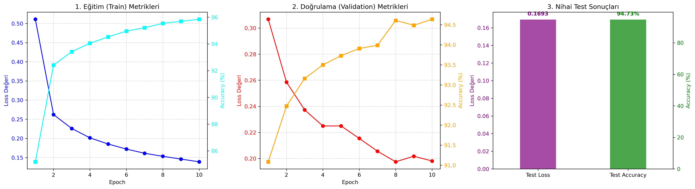
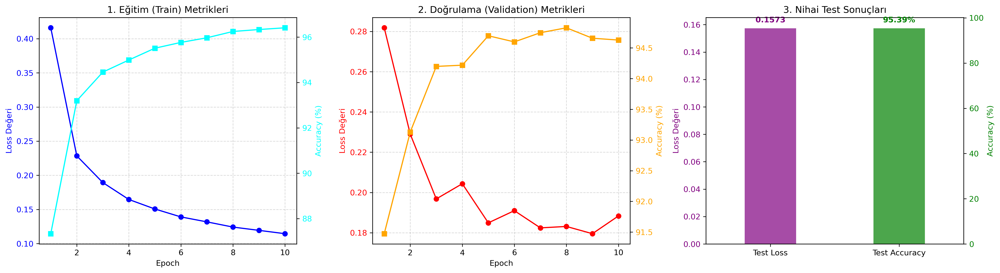
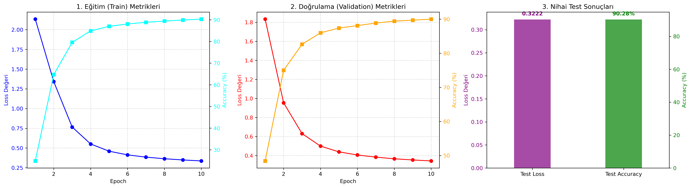
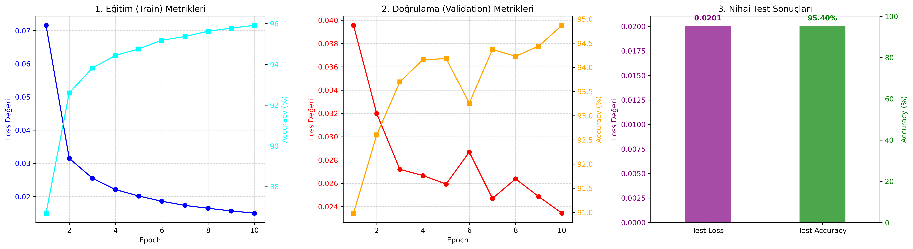
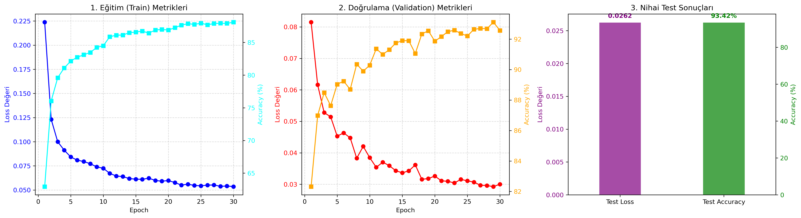
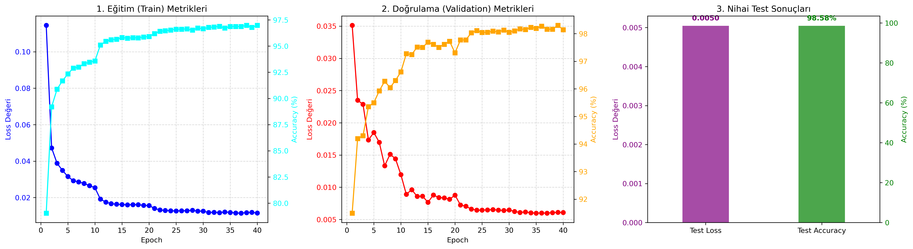

# 🚀 MNIST El Yazısı Rakam Tanıma ve MLP Optimizasyon Analizi

Bu proje, MNIST el yazısı rakam tanıma veri seti kullanılarak, **Konvolüsyonel Sinir Ağları (CNN) veya hazır (pre-trained) modeller kullanılmadan**, sıfırdan bir Çok Katmanlı Algılayıcı (Multi-Layer Perceptron - MLP) mimarisinin geliştirilmesi, adım adım optimize edilmesi ve laboratuvar verisi ile gerçek dünya verisi arasındaki **Dağılım Kayması (Distribution Shift)** olgusunun analiz edilmesi amacıyla hazırlanmıştır.

---

## 🎯 1. Proje Amacı ve Beklenen Öğrenme Çıktıları
Ödevin temel isterleri doğrultusunda aşağıdaki hedefler başarıyla gerçekleştirilmiştir:
* **MLP Mimarisi & Sıfırdan Eğitim:** Sadece `nn.Linear` katmanları ve `ReLU` kullanılarak en az 2 gizli katmanlı bir model tasarlanmış ve sıfırdan eğitilmiştir.
* **Veri İzolasyonu:** Train, Validation ve Test split işlemleri yalıtılmış, veri sızıntısı (Data Leakage) engellenmiştir.
* **Hiperparametre Analizi:** Adam vs. SGD, CrossEntropy vs. MultiMarginLoss gibi farklı konfigürasyonların performansa etkileri kıyaslanmıştır.
* **Gerçek Dünya Verisi ile Genelleme (Generalization):** Öğrencinin kendi el yazısıyla oluşturduğu veri seti kullanılarak modelin "ezberleme" oranı test edilmiştir.

---

## 📂 2. Kendi Test Verimizi Oluşturma (Gerçek Dünya Verisi)

Modelin ezberleyip ezberlemediğini (overfitting) ölçmek için özel bir görüntü işleme hattı (pipeline) kurulmuştur. 

### Aşama 1: Ham Veri Toplama
Rakamlar A4 kağıdına kalemle yazılmış ve fotoğraflanmıştır. Modelin farklı varyasyonları görebilmesi için rakamlar farklı kalınlık ve eğimlerle yazılmıştır.
 

### Aşama 2: Otomatik Kırpma (`kirpma_2.py`)
Yazılan sayfalar OpenCV kullanılarak taranmış, `findContours` ile kontur tespiti yapılıp rakamlar ağırlık merkezine göre ortalanarak kare şeklinde kırpılmıştır.
 

### Aşama 3: Dijitalizasyon ve MNIST Formatı (`mnist_format_donusturme.py`)
Kırpılan resimler Otsu Thresholding ile tersine çevrilmiş (**siyah arka plan, beyaz rakam**) ve pürüzsüzleştirilerek 28x28 boyutuna indirgenmiştir. Hazırlanan veriler, yazılan özel `Dataset` sınıfı (`test_data_loader.py`) ile klasör isimlerinden otomatik etiketlenmiştir.
 

---

## 🔬 3. Model Evrimi ve Grafiksel Karşılaştırmalar

Modeller, kapasite genişletmenin etkisini net görmek adına Final (V7) modeline kadar **bilinçli olarak 16 nöronluk dar bir kapasitede (Bottleneck)** (`784 -> 16 -> 10`) tutulmuştur.

### 📉 A. Temel Model (Base) ve Normalizasyonun Etkisi
Hiçbir işlem görmemiş `v1` modelimiz eğitimde iyi gibi görünse de (Validasyon %94+), kendi yazdığım rakamlarda **%35.79**'da kalarak tamamen çökmüştür. Modele girdi verisini MNIST ortalama ve standart sapmasıyla **Normalize** ettiğimizde ise başarı anında artmıştır.

  
  

### 📉 B. Optimizatör Karşılaştırması: Adam vs SGD
Mimarimizi Adam yerine SGD optimizatörü ile eğittiğimizde yakınsamanın (convergence) ne kadar yavaş olduğu grafikten açıkça görülmektedir. SGD ile MNIST testi %90'da, gerçek dünya testi ise %71.44'te kalmıştır.
 

### 📉 C. Kayıp Fonksiyonu: CrossEntropy vs MultiMarginLoss
`CrossEntropy` yerine karar sınırlarını (margin) maksimize eden `MultiMarginLoss` denendiğinde modelin validasyon çizgisi ciddi bir stabilite kazanmış ve gerçek dünya başarısı **%80.90**'a taşınmıştır.
 

### 📉 D. Darboğazı Aşmak: Veri Artırımı ve LR Scheduler (V6)
Modelin 16 nöronluk kapasitesinin limitlerini görmek için; `RandomAffine` ile uzamsal esneklik, lokal minimumlara pürüzsüz inmek için `StepLR` (Her 10 epoch'ta LR düşüşü) ve `L2 Regularization` eklendi. Aşağıdaki grafikte StepLR'ın öğrenme oranını düşürmesiyle Loss'un nasıl aşağı çekildiği net bir şekilde görülmektedir.
 

### 📉 E. Final Modeli (V7): Kapasite Artışı ile Zirve Noktası
16 nöronluk limitler sonuna kadar "sömürüldükten" sonra, mimari genişletilerek `784 -> 64 -> 64 -> 10` formatına getirildi. V6'nın mükemmel kurgusuyla 40 epoch eğitilen V7 modeli, **MNIST testinde %98.58**, kendi el yazım verisinde ise **%96.30** başarı elde ederek Distribution Shift problemini tamamen çözmüştür.
 

---

## 📊 4. Performans ve Metrik Karşılaştırma Tablosu

Tüm optimizasyonların "Laboratuvar Ortamı" (MNIST) ve "Gerçek Dünya" (Kendi El Yazım) verisindeki başarımları aşağıdadır:

| Model Adı | Gizli Nöron | Optimizatör & Loss | Özellik / İyileştirme | MNIST Test Accuracy | Kendi El Yazım Accuracy |
| :--- | :---: | :--- | :--- | :---: | :---: |
| **v1 (Base)** | 16 | Adam, CrossEntropy | Ham Veri, Transform Yok | %94.72 | **%35.79** |
| **v1 (Normalized)**| 16 | Adam, CrossEntropy | Sadece Normalizasyon | %95.38 | %73.92 |
| **v2 (SGD)** | 16 | SGD, CrossEntropy | Adam yerine SGD | %90.27 | %71.44 |
| **v3 (MultiMargin)**| 16 | Adam, MultiMargin | Hata fonksiyonu değişti | %95.39 | %80.90 |
| **v4 (Aug Leakage)**| 16 | Adam, CrossEntropy | Aşırı Augment + Validasyon Sızıntısı | %73.06 | %77.21 |
| **v5 (Minimize Aug)**| 16 | Adam, CrossEntropy | Sızıntı Çözüldü + RandomRotation | %95.14 | %80.79 |
| **v5 (MM + Aug)** | 16 | Adam, MultiMargin | V5'e MultiMargin Eklendi | %95.30 | %82.61 |
| **v6 (Scheduler)** | 16 | Adam, MultiMargin | RandomAffine + StepLR + L2 Reg. (30 Ep) | %93.42 | %86.71 |
| **v6 (Scheduler+)** | 16 | Adam, MultiMargin | Gamma 0.3 + (40 Ep) Limitsel Zirve | %93.63 | %88.56 |
| **v7 (Final Model)**| **64** | **Adam, MultiMargin** | **V6 Ayarları + Kapasite Artışı** | **%98.58** | **%96.30** |

---

## 🏆 5. Sonuç
Bu projede en çarpıcı sonuç, modelin kapalı laboratuvar ortamındaki veri seti ile dış dünyadan, cep telefonu kamerasıyla gelen ham veri arasındaki başarım farkıdır. İlk kurulan `Base` model, ezber yaptığı için gerçek hayatta tamamen başarısız olmuştur. Verilerin OpenCV ile önişlemeden geçirilmesi, veri sızıntısının (Data Leakage) önlenmesi, uygun hata fonksiyonu (MultiMargin) seçimi ve dinamik öğrenme oranları (StepLR) ile MLP modeli başarılı bir şekilde gerçek dünya senaryolarına adapte edilmiştir.
