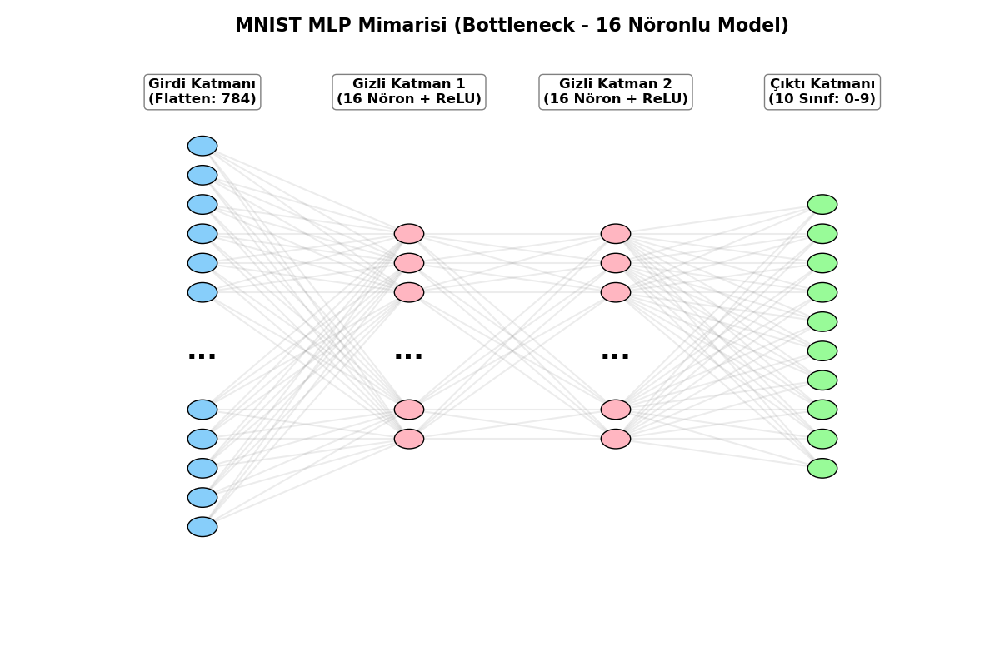
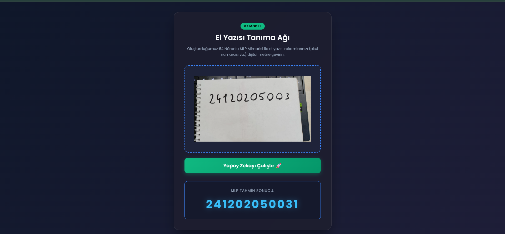

# 🚀 MNIST El Yazısı Rakam Tanıma ve MLP Optimizasyon Analizi

Bu proje, MNIST el yazısı rakam tanıma veri seti kullanılarak, **Konvolüsyonel Sinir Ağları (CNN) veya hazır (pre-trained) modeller kullanılmadan**, sıfırdan bir Çok Katmanlı Algılayıcı (Multi-Layer Perceptron - MLP) mimarisinin geliştirilmesi, adım adım optimize edilmesi ve laboratuvar verisi ile gerçek dünya verisi arasındaki **Dağılım Kayması (Distribution Shift)** olgusunun analiz edilmesi amacıyla hazırlanmıştır. 

Ayrıca eğitilen model, uçtan uca (end-to-end) çalışan bir web uygulamasına dönüştürülerek son kullanıcı deneyimine sunulmuştur.

---

## 🎯 1. Beklenen Öğrenme Çıktılarının Karşılanması

Ödevin temel isterleri doğrultusunda aşağıdaki hedefler başarıyla gerçekleştirilmiştir:

* **MLP Mimarisi & Sıfırdan Eğitim:** CNN kullanılmadan tamamen `nn.Linear` katmanları ile inşa edilmiş, pre-trained hiçbir veri kullanılmamıştır.
* **Veri İzolasyonu:** Train, Validation ve Test split işlemleri manuel randomizasyon (Seed: 42) ile bölünmüş, `test_transform` ile Validation ve Test verilerine veri artırımı (augmentation) sızması engellenmiştir.
* **Hiperparametre Analizi:** Adam vs. SGD, CrossEntropy vs. MultiMarginLoss gibi farklı konfigürasyonların performansa etkileri grafiklerle kıyaslanmıştır.
* **Gerçek Dünya Verisi ile Genelleme (Generalization):** Öğrencinin kendi el yazısıyla oluşturduğu veri seti kullanılarak modelin "ezberleme" oranı test edilmiştir.
* **Uygulama (Deployment):** Eğitilen model bir FastAPI web sunucusuna entegre edilerek gerçek zamanlı tahmin yapan bir arayüze bağlanmıştır.

---

## 📂 2. Kendi Test Verimizi Oluşturma (Gerçek Dünya Verisi)

Modelin ezberleyip ezberlemediğini (overfitting) ölçmek için özel bir görüntü işleme hattı (pipeline) kurulmuştur. 

### Aşama 1: Ham Veri Toplama
Rakamlar A4 kağıdına kalemle yazılmış ve fotoğraflanmıştır. Modelin farklı varyasyonları görebilmesi için rakamlar farklı kalınlık ve eğimlerle yazılmıştır.

***Görsel 2.1: A4 kağıdına yazılmış ham gerçek dünya verisi (6 Rakamları)***

### Aşama 2: Otomatik Kırpma (`kirpma_2.py`)
Yazılan sayfalar OpenCV kullanılarak taranmış, `findContours` ile kontur tespiti yapılıp rakamlar ağırlık merkezine göre ortalanarak kare şeklinde kırpılmıştır.

***Görsel 2.2: OpenCV algoritması ile otonom olarak bulunup kırpılan ham "6" rakamı***

### Aşama 3: Dijitalizasyon ve MNIST Formatı (`mnist_format_donusturme.py`)
Kırpılan resimler Otsu Thresholding ile tersine çevrilmiş (**siyah arka plan, beyaz rakam**) ve pürüzsüzleştirilerek 28x28 boyutuna indirgenmiştir. Hazırlanan veriler, yazılan özel `Dataset` sınıfı (`test_data_loader.py`) ile klasör isimlerinden otomatik etiketlenmiştir.

***Görsel 2.3: Tensör formatına girmeden önce 28x28 MNIST renk uzayına dönüştürülmüş final test verisi***

---

## 🔬 3. Model Evrimi ve Grafiksel Karşılaştırmalar

Modeller, kapasite genişletmenin etkisini net görmek adına Final (V7) modeline kadar **bilinçli olarak 16 nöronluk dar bir kapasitede (Bottleneck)** (`784 -> 16 -> 10`) tutulmuştur. 

### 🧠 Ağ Mimarisi Görselleştirmesi
Modelimizin girdi verisini (784 piksel) nasıl çok dar bir boğaza (16 nöron) sıkıştırıp ardından 10 sınıfa çıkardığını aşağıdaki sembolik mimari tasarımdan görebilirsiniz. Bu dar kapasite, modelin sınırlarını analiz etmemize ve yapılan optimizasyonların (loss, optimizer, scheduler vb.) etkisini net bir şekilde gözlemlememize olanak tanımıştır.

***Görsel 3.1: MNIST veri seti için tasarlanan 16 Nöronlu (Bottleneck) Çok Katmanlı Algılayıcı (MLP) Mimarisi***

### 📉 A. Temel Model (Base) ve Normalizasyonun Etkisi
Hiçbir işlem görmemiş `Base (v1)` modelimiz eğitimde iyi gibi görünse de, kendi yazdığım rakamlarda **%35.79**'da kalarak tamamen çökmüştür. Modele girdi verisini MNIST ortalamasıyla **Normalize** ettiğimizde ise başarı anında artmıştır.

***Grafik 3.1: v1 Base Modeli Eğitim Metrikleri (Normalizasyon YOK - Gerçek Dünya Başarısı: %35.79)***

***Grafik 3.2: v1 Normalize Modeli Eğitim Metrikleri (Normalizasyon VAR - Gerçek Dünya Başarısı: %73.92)***

### 📉 B. Optimizatör Karşılaştırması: Adam vs SGD
Mimarimizi Adam yerine SGD optimizatörü ile eğittiğimizde yakınsamanın (convergence) ne kadar yavaş olduğu, Loss değerinin düşmekte zorlandığı açıkça görülmektedir.

***Grafik 3.3: SGD Optimizatörü ile Yavaş Yakınsama (Test Accuracy: %90.27)***

### 📉 C. Kayıp Fonksiyonu: CrossEntropy vs MultiMarginLoss
Sınıflandırmada geleneksel `CrossEntropy` yerine karar sınırlarını (margin) maksimize eden `MultiMarginLoss` denendiğinde modelin validasyon çizgisi (kırmızı çizgi) ciddi bir stabilite kazanmış ve gerçek dünya başarısı **%80.90**'a taşınmıştır.

***Grafik 3.4: MultiMargin Loss Kullanımı (Daha stabil ve pürüzsüz validasyon çizgisi)***

### 📉 D. Darboğazı Aşmak: Veri Artırımı ve LR Scheduler (V6)
Modelin 16 nöronluk kapasitesinin limitlerini görmek için uzamsal esneklik sağlayan `RandomAffine` ve lokal minimumlara pürüzsüz inmek için `StepLR` eklendi. Aşağıdaki grafikte StepLR'ın her 10 epoch'ta öğrenme oranını düşürmesiyle Loss'un nasıl kademeli olarak aşağı çekildiği net bir şekilde görülmektedir.

***Grafik 3.5: V6 Modeli - StepLR ve RandomAffine ile sınırların zorlanması***

### 📉 E. Final Modeli (V7): Kapasite Artışı ile Zirve Noktası
16 nöronluk limitler sonuna kadar "sömürüldükten" sonra, mimari genişletilerek `784 -> 64 -> 64 -> 10` formatına getirildi. V6'nın mükemmel kurgusuyla 40 epoch eğitilen V7 modeli, **MNIST testinde %98.58**, kendi el yazım verisinde ise **%96.30** başarı elde ederek Distribution Shift problemini tamamen çözmüştür.

***Grafik 3.6: V7 Final Modeli (64 Nöron) - Mükemmel Uyum ve Yüksek Genelleme Yeteneği***

---

## 📊 4. Performans ve Metrik Karşılaştırma Tablosu

Tüm optimizasyonların "Laboratuvar Ortamı" (MNIST Test) ve "Gerçek Dünya" (Kendi El Yazım Testi) verisindeki başarımları aşağıdadır:

| Model Adı | Gizli Nöron | Optimizatör & Loss | Özellik / İyileştirme | MNIST Test | Kendi El Yazım |
| :--- | :---: | :--- | :--- | :---: | :---: |
| **v1 (Base)** | 16 | Adam, CrossEntropy | Ham Veri, Transform Yok | %94.72 | **%35.79** |
| **v1 (Normalized)**| 16 | Adam, CrossEntropy | Sadece Normalizasyon | %95.38 | %73.92 |
| **v2 (SGD)** | 16 | SGD, CrossEntropy | Adam yerine SGD | %90.27 | %71.44 |
| **v3 (MultiMargin)**| 16 | Adam, MultiMargin | Hata fonksiyonu değişti | %95.39 | %80.90 |
| **v4 (Aug Leakage)**| 16 | Adam, CrossEntropy | Aşırı Augment + Validasyon Sızıntısı | %73.06 | %77.21 |
| **v5 (Minimize Aug)**| 16 | Adam, CrossEntropy | Sızıntı Çözüldü + RandomRotation | %95.14 | %80.79 |
| **v5 (MM + Aug)** | 16 | Adam, MultiMargin | V5'e MultiMargin Eklendi | %95.30 | %82.61 |
| **v6 (Scheduler)** | 16 | Adam, MultiMargin | RandomAffine + StepLR (30 Ep) | %93.42 | %86.71 |
| **v6 (Scheduler+)** | 16 | Adam, MultiMargin | Gamma 0.3 + (40 Ep) Limitsel Zirve | %93.63 | %88.56 |
| **v7 (Final Model)**| **64** | **Adam, MultiMargin** | **V6 Ayarları + Kapasite Artışı** | **%98.58** | **%96.30** |

---

## 📁 5. Proje Dosya Yapısı

* `mnist.ipynb`: Veri setlerinin yüklendiği, tüm mimarilerin sıfırdan oluşturulup eğitildiği ana Notebook.
* `kirpma_2.py`: Fiziksel A4 kağıtlarından el yazısı rakamları OpenCV ile tespit edip otonom kesen betik.
* `mnist_format_donusturme.py`: Kırpılan resimleri MNIST renk uzayına (Invert & Otsu) ve boyutuna eşitleyen kod.
* `test_data_loader.py`: Özel fotoğrafları PyTorch formatına sokan özel `Dataset` sınıfı.
* `toplu_test_2.py`: Eğitilmiş tüm modelleri çekip toplu test yapan otomasyon kodu.
* **`web_app/`**: Eğitilen modelin son kullanıcıya sunulduğu uçtan uca web uygulamasının klasörü.
  * `main.py`: FastAPI sunucusu, modelin yüklenmesi ve OpenCV destekli görüntü işleme backend'i.
  * `static/`: HTML, CSS ve JavaScript tabanlı, sürükle-bırak destekli karanlık temalı web arayüzü.

---

## 🏆 6. Sonuç, Dağılım Kayması ve Uçtan Uca Web Uygulaması

Bu proje kapsamında en çarpıcı bulgu, bir yapay zeka modelinin "Laboratuvar Ortamı" (MNIST) ile "Gerçek Dünya" verisi arasındaki başarım farkının ne kadar dramatik olabileceğinin ispatlanmasıdır. Karşılaşılan temel sorunlar ve mühendislik çözümleri aşağıdadır:

### ⚠️ A. Dağılım Kayması (Distribution Shift) Problemi
Hiçbir ön işleme tabi tutulmayan ilk modelimiz, standart MNIST testinde %94.72 doğruluk almasına rağmen gerçek hayatta (kamera verisi) **%35.79**'da çakılmıştır. Model MNIST'in piksel dizilimlerini ezberlemiş, farklı bir kalem/kağıt gördüğünde afallamıştır.

### 🛠️ B. Veri Sızıntısı (Data Leakage) Hatası
Modelin esnekliğini artırmak için eklenen Data Augmentation işlemleri yanlışlıkla Validasyon setine sızdığında (V4 Modeli) başarım %73'lere düşmüştür. Kod seviyesinde dönüşümler ayrılarak sızıntı giderilmiş ve stabilite sağlanmıştır.

### 🧠 C. Optimizatör, Kayıp Fonksiyonu ve Dinamik Öğrenme
Geleneksel `SGD` ve `CrossEntropyLoss` yerine, `Adam`, `MultiMarginLoss` ve `StepLR` (Dinamik Öğrenme Oranı) kullanılması, 16 nöronluk dar darboğazdan (bottleneck) maksimum verimin alınmasını sağlamış ve gerçek dünya başarısını **%88.56**'ya taşımıştır. Fiziksel limitlerin tükendiği noktada mimari genişletilerek (V7 Modeli) **%96.30** başarıya ulaşılmıştır.

### 🌐 D. Uçtan Uca (End-to-End) Kullanıcı Odaklı Web Uygulaması
Projenin sadece bir jupyter notebook betiği olarak kalmaması ve gerçek son kullanıcı deneyiminin (UX) test edilebilmesi amacıyla, eğitilen en başarılı **V7 Modeli**, FastAPI tabanlı bir web uygulamasına dönüştürülmüştür. 

Kullanıcıların sisteme yüklediği fotoğraflardaki arka plan gürültülerini (klavye tuşları, defter spirali, ışık yansımaları) elimine etmek ve MNIST formatını birebir taklit etmek için arka planda profesyonel bir görüntü işleme hattı (pipeline) kurulmuştur:
1. **İki Aşamalı (Two-Step) Kırpma:** Sistem önce tüm yazıyı tek bir blok (Büyük Kırmızı Kutu) olarak tespit edip arkaplandan soyutlar, ardından bu blok içindeki rakamları tek tek ayıklar.
2. **Kütle Merkezi (Center of Mass) Hizalaması:** Yann LeCun'un orijinal MNIST veri setini oluştururken kullandığı fiziksel kütle merkezi formülü (`cv2.moments`) koda entegre edilmiştir. Bu sayede kullanıcı rakamları nasıl yazarsa yazsın, rakamların ağırlık merkezi 28x28 piksel tuvalin tam ortasına (14, 14 koordinatına) matematiksel olarak sabitlenmektedir.

***Görsel 6.1: OpenCV destekli görüntü işleme algoritmaları ve eğitilen 64 Nöronlu V7 modelinin FastAPI web arayüzünde okul numarasını gerçek zamanlı tahmin etmesi.***
